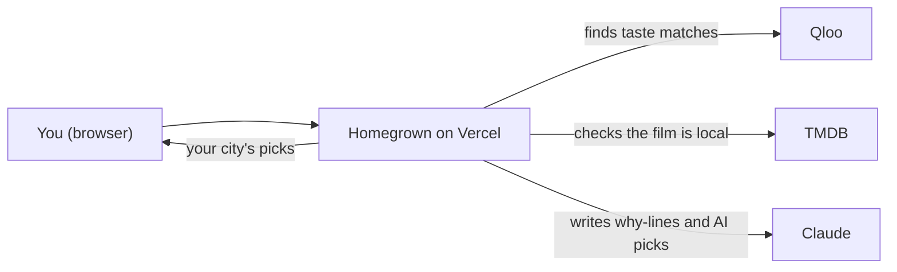
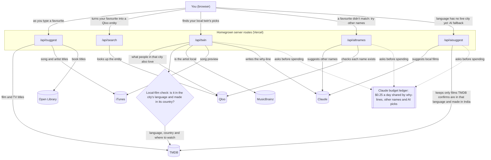

# Homegrown

## What

Homegrown is a small web app. You tell it a few shows or films you love. You pick a city whose language you are learning. It shows you films from there. Each film was really made there, in that language.

Each film card shows:

- a short reason why you might like it, tied to your favourites
- how hard it may be for a learner: easy, medium or hard (marked "estimated")
- where to watch it

## Why

It is hard to find films from another country that match your taste. Most lists show what is popular, not what you like. Homegrown starts from your own favourites. It aims to answer one question: "What would I love if I had grown up there?"

## How it works

1. **You type a favourite.** As you type, suggestions come from free catalogues: TMDB, iTunes and Open Library. When you choose one, the app looks it up in Qloo, a taste service.
2. **If Qloo can't find it,** Claude suggests other names for that title. The app then tries those names in Qloo.
3. **You pick a city.** Each city has its own language. A city goes live only when at least 60% of its picks check out as truly local.
4. **The app asks Qloo** for films people in that city enjoy, based on your favourites. Qloo only allows a few calls at a time, so the app waits about 7 seconds between calls. If Qloo says "slow down", it waits 14 s, 28 s, then 30 s.
5. **Each film is checked in TMDB.** It must be in the city's language and come from that country. Films that fail are dropped.
6. **Each film gets a reason line.** One Claude call writes lines for all films at once. The app checks every line. A line must name your favourite. Its other words must come from the descriptions of the film and your favourite. Lines with numbers, links or words like "not" are thrown away. If a line fails, the app uses a simple line built from the tags your favourite and the film share. It may ask Claude once more for the lines that failed.
7. **Each film gets a difficulty.** It comes from the film's genres and length. Claude's view of the pace and amount of talking can move it one step.
8. **Some languages are "coming soon".** They don't have enough checked films yet. For some of them, Claude suggests films. Each one is checked in TMDB first. These are labelled "Suggested by AI, not taste-matched".
9. **Spending is capped.** All Claude use shares one daily limit of $0.25. It is split into $0.10 for reason lines, $0.08 for other names, and $0.07 for suggested films. Each visitor also has a daily cap. These limits are kept in memory, so each server copy counts on its own.

Only films are live right now. The code can also handle TV shows and music, but those are switched off.

## Getting started

1. **Install Node.js 22 or newer.**

2. **Clone the code.**

   ```sh
   git clone https://github.com/sivaratrisrinivas/homegrown.git
   cd homegrown
   ```

   There are no packages to install.

3. **Set these environment variables.** Get your own keys from each service. Never commit them.

   - `QLOO_API_KEY`: needed for search and picks.
   - `TMDB_API_KEY`: needed to check films and find where to watch them.
   - `ANTHROPIC_API_KEY`: for Claude. Without it, the app still works. It uses the simple reason lines and skips the Claude features.
   - `PORT`: optional, for local runs only. The default is 3000.

4. **Run it locally.**

   ```sh
   npm run dev
   ```

   Open http://localhost:3000.

5. **Run the tests.**

   ```sh
   npm test
   ```

   The tests use fake services, so they need no keys.

6. **Deploy to Vercel.**
   1. Import the GitHub repo as a new Vercel project. No build step is needed.
   2. Add the three API keys under Settings, then Environment Variables.
   3. Deploy. Files in `public/` are served as the site. Files in `api/` become server functions.

## System architecture

### High-level architecture

The big picture: your browser talks to Homegrown, and Homegrown asks three outside services for help.



### Low-level architecture

The detailed view: each server route, the outside services it really calls, the local-film check, the AI fallback and the shared Claude budget.



## Data licence and attribution

Word frequency lists come from [hermitdave/FrequencyWords](https://github.com/hermitdave/FrequencyWords) (2018 release, from OpenSubtitles), licensed [CC-BY-SA-4.0](https://creativecommons.org/licenses/by-sa/4.0/). `data/freq/` and `public/vocab-test.json` are modified derivatives of those lists (re-tokenised, trimmed, filtered and sampled) and are shared under the same licence, CC-BY-SA-4.0.
